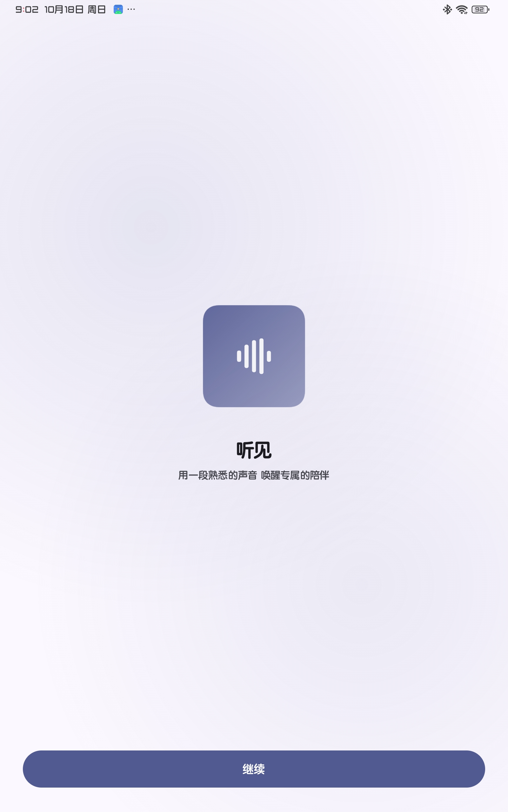
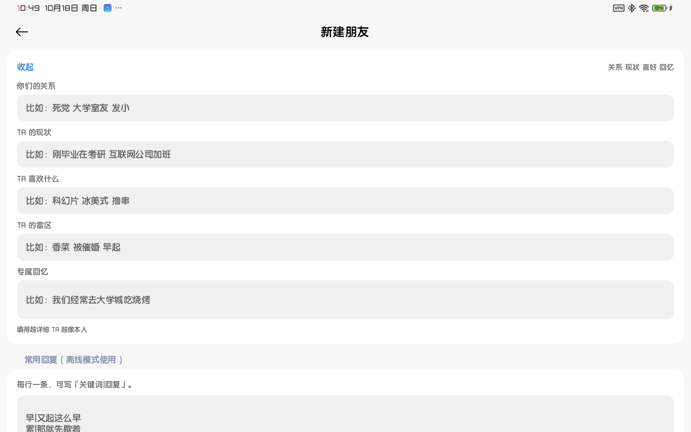
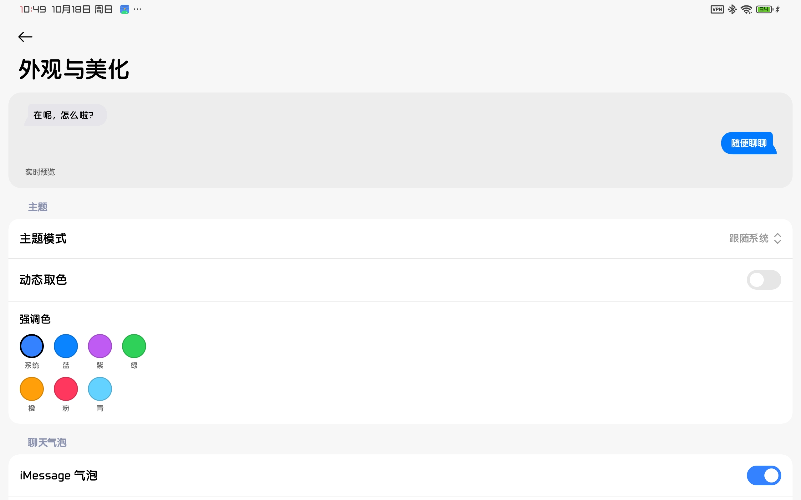

# FriendSim

<p align="center"><b>一款可以让你跟朋友对话的简易聊天工具</b><br>
<i>A minimal chat app that lets you keep talking to someone you miss.</i></p>

<p align="center">
  <a href="LICENSE"></a>
  
  <a href="https://github.com/Mingqingke/FriendSim/actions"></a>
</p>

<p align="center">
  
  
  
</p>

---

导入一张照片、一段声音，就能和一个「像 TA」的朋友继续聊下去。

不用注册，不用填 Key，断网也能回你话。

## 亮点

- **不用配置就能聊** — 自备 Key 优先，没有就自动走免 Key 公共端点，再不行切本地预设，全程静默降级
- **像一个具体的人** — 关系、现状、性格、口头禅、喜好、雷区、专属回忆，结构化注入 Prompt；说错话会真的炸
- **会记得** — 最近上下文 + 长期记忆，聊久了自动压成「回忆」；有好感度、关系阶段和心境
- **手感做了很多遍** — iMessage 连续曲率气泡与泪滴尾巴、共享元素转场、弹簧动画、分级触感
- **数据留在本机** — 聊天记录加密保存，照片与录音不出设备，一键备份或彻底清除

## 功能

**聊天**

- 流式回复：先「正在输入」，再逐字出现
- 语音条、图片消息（图片会交给视觉模型识别）、长消息折叠
- 引用回复、重新生成、从这里重来、复制、删除
- 发送失败点红点重发；断网只在输入框上方留一行小字

**人设与记忆**

- 灵魂档案：关系、现状、性格、口头禅、喜好、雷区、专属回忆、纪念日、心境
- 好感度与关系阶段：刚认识 → 熟络 → 好友 → 特别的人
- 情境感知：时间、星期、天气、你们的纪念日
- 主动消息：隔了几小时、不在深夜时，会先开口问你一句

**外观**

- 主题、动态取色、强调色
- 气泡：iMessage 风格 / 普通样式，圆角、配色、字号、字体可调
- 聊天背景：纯色或相册图片，带模糊与暗度
- 应用图标可伪装成计算器或备忘录

**系统**

- 通知栏快捷回复，不打开 App 也能回
- 导出聊天长图
- 备份 / 恢复（含照片与录音）

## 下载

[Releases](https://github.com/Mingqingke/FriendSim/releases) 里下载 `apk`，Android 8.0 以上，arm64。

## 构建

需要 JDK 21 与 Android SDK 37。根目录新建 `local.properties`：

```properties
sdk.dir=/path/to/android-sdk
```

```bash
./gradlew assembleDebug     # 调试包
./gradlew assembleRelease   # 正式包（需 keystore.properties）
```

## 许可

GPL-3.0，见 [LICENSE](LICENSE)。

作者：青
